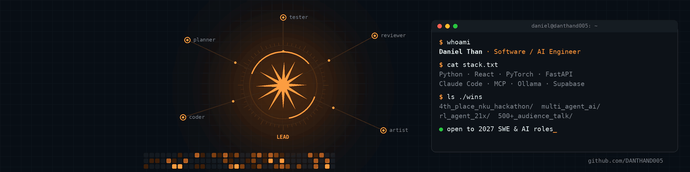
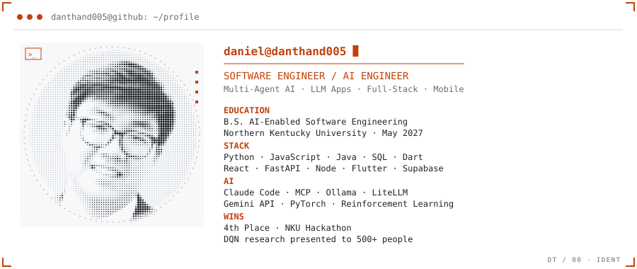
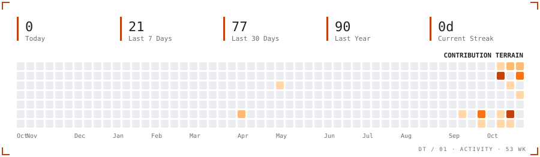
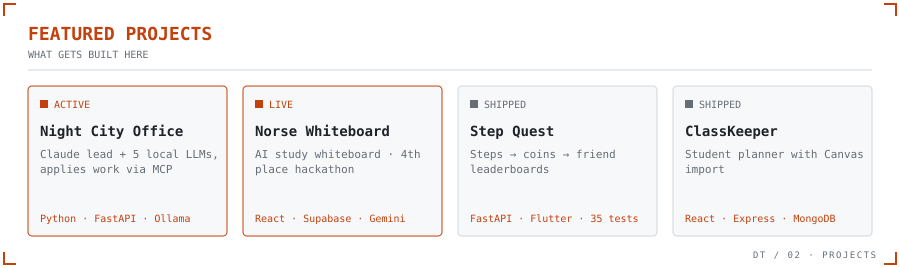

<!-- Cards are generated by scripts/cards.py and refreshed daily by .github/workflows/cards.yml -->

<picture>
  <source media="(prefers-color-scheme: dark)" srcset="ident_dark.svg">
  
</picture>

<picture>
  <source media="(prefers-color-scheme: dark)" srcset="activity_dark.svg">
  
</picture>

<picture>
  <source media="(prefers-color-scheme: dark)" srcset="projects_dark.svg">
  
</picture>

| PROJECT | WHAT IT IS | LINKS |
|---|---|---|
| **Night City Office** | A Claude lead plans and reviews work for 5 local LLMs across two machines, then applies it to Roblox Studio, Blender and Figma through MCP | [Code](https://github.com/DANTHAND005/night-city-office) |
| **Norse Whiteboard** | AI study whiteboard with live drawing and a Gemini tutor. 4th place, NKU Hackathon | [Live demo](https://danthand005.github.io/Hackathon-Norse-Whiteboard/) · [Code](https://github.com/DANTHAND005/Hackathon-Norse-Whiteboard) |
| **Step Quest** | iPhone steps → coins → friend leaderboards. FastAPI + Flutter, 35 tests | [Code](https://github.com/DANTHAND005/step-quest) |
| **ClassKeeper** | Full-stack student planner with Canvas LMS import | [Code](https://github.com/DANTHAND005/classkeeper) |

<b>ALL PUBLIC REPOS</b>

<!-- repos:start -->
| REPO | LANG | LAST PUSH | NOTE |
|---|---|---|---|
| [Hackathon-Norse-Whiteboard](https://github.com/DANTHAND005/Hackathon-Norse-Whiteboard) | JavaScript | 2026-10-04 | AI study whiteboard with live drawing and a Gemini tutor. 4th place, NKU Hackathon 2026. React, Supabase. |
| [step-quest](https://github.com/DANTHAND005/step-quest) | Dart | 2026-10-21 | Social step-tracking game: iPhone steps become coins and friend leaderboards. Flutter app, FastAPI backend, 35 tests. |
| [AI-Snake-Game](https://github.com/DANTHAND005/AI-Snake-Game) | Python | 2026-04-10 | Deep Q-Learning agent in PyTorch that learns Snake. Peak score 63, 21x the untrained baseline. NKU undergraduate research. |
| [classkeeper](https://github.com/DANTHAND005/classkeeper) | JavaScript | 2026-05-08 | Full-stack student planner that imports assignments from the Canvas LMS API. React, Node.js, Express, MongoDB, JWT. |
<!-- repos:end -->

  
<strong>SOFTWARE ENGINEERING · AI ENGINEERING · LOOKING FOR 2027 ROLES</strong>

  
<a href="https://www.linkedin.com/in/danielthan2025">LinkedIn</a> · <a href="mailto:than.daniel005@gmail.com">Email</a>

